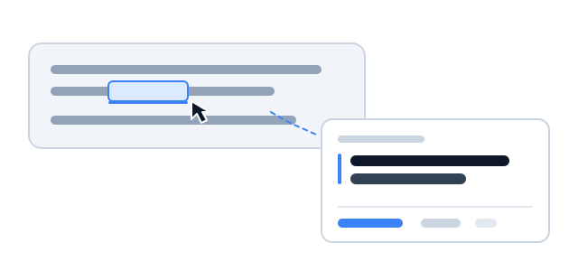

# dsh-word-translate

English | [中文](README.zh.md)

Right-click any English word in the DSH conversation — in your own message or in the assistant's reply — and a small card offers **翻译成中文** (translate to Chinese). Press it and the Chinese meaning appears in place, ready to copy. No copying the word into a browser or dictionary, and no API key.



## Install

```sh
dsh plugin add dsh-word-translate
```

Or from the Plugins page: **Discover** → search `dsh-word-translate` → Install. The bundle affects the whole profile and stays installed across restarts.

## Use

1. Select an English word in any message, or just point at it — the plugin also picks up the word under the pointer when nothing is selected.
2. Right-click. The native menu is replaced by a small card showing the chosen word.
3. Choose **翻译成中文**. The translation appears in the card; **复制译文** copies it and **重试** asks again.

Press `Esc`, click outside the card, or scroll to dismiss it. Right-clicks inside input boxes, text areas, and editable text are left to the browser, so the composer keeps its own menu.

Selection is capped at 800 characters per request; a single word or phrase is well below that.

## Configuration

Optional, in the profile's `cordis.patch.yml` under this plugin's `config`:

| Key | Meaning | Default |
| --- | --- | --- |
| `providers` | Providers to try in order: `['bing']`, `['google']`, or both | `['bing', 'google']` |
| `targetLanguage` | `zh-CN` (Simplified) or `zh-TW` (Traditional) | `zh-CN` |
| `maxChars` | Longest text translated in one request (at most 2000) | `2000` |

## Privacy

The selected text is sent to an anonymous machine-translation endpoint: [Bing](https://edge.microsoft.com/translate/translatetext) first, [Google](https://translate.googleapis.com/translate_a/single) as a fallback. Nothing is stored — results are cached in memory only for the current process (at most 500 entries), and the plugin sends no text anywhere else. Turning the plugin off removes the right-click card, both routes, and the cache.

## Endpoints

- `POST /dsh-word-translate/translate` with `{"text": "...", "targetLanguage": "zh-CN"}` returns `{"ok": true, "translation": "...", "provider": "bing", "cached": false, "truncated": false}`.
- `GET /dsh-word-translate/health` reports the active providers, target language, and cache size.

Both listen on the loopback interface only, like every other DSH HTTP route. One request times out after 10 seconds; the response body is capped at 1 MiB.

## Limitations

- Only Latin-script words are translated; text without `A-Z` is rejected.
- Right-clicking a link or a word inside a link opens the translation card instead of the browser's link menu.
- Results depend on the public translation endpoints; when both fail the card shows the error and offers **重试**.

## License

MIT
