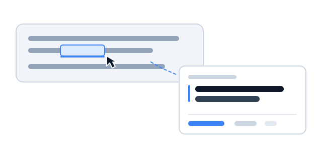

# 划词翻译

在对话里遇到不认识的英文单词，不用再复制出去查——选中它、或者把鼠标停在上面，右键就会弹出「翻译成中文」卡片，中文释义就地显示。

## 怎么用

- **选中再右键**：选中单词或短语（比如 `idempotent`、`context window`），右键，卡片里点「翻译成中文」。
- **不选中也能用**：直接把鼠标停在某一行上右键，会自动取光标下的那个词，省去先选中的一步。
- 卡片里可以**复制译文**、失败时**重试**；底部会标出这次结果来自哪个翻译服务。
- 关掉它：按 `Esc`、点卡片外面、或者滚一下对话都行。
- **输入框不受影响**：聊天输入框、设置里的输入框，右键仍是系统原生菜单——只有对话正文才接管。

## 翻译从哪来

- 主用微软 Bing 的公开翻译接口，失败自动切到 Google。
- **不需要 API Key、不需要登录**，也**不消耗模型的 token**，译文不会写进会话记录，模型看不到它。
- 只把被查的那一小段文字发出去，不会发送你的对话内容。

## 速度与缓存

- 同一 profile 内的内存缓存最多 500 条，同一个词再查直接命中，不再发请求。
- 单次请求 10 秒超时；翻译文本上限 2000 字符，选中内容超过 800 字符时只翻前 800 字符并在卡片上标注「已截断」。

## 配置

| 配置项 | 默认值 | 说明 |
| --- | --- | --- |
| `providers` | `["bing","google"]` | 翻译服务及尝试顺序 |
| `targetLanguage` | `zh-CN` | 目标语言，可改成 `zh-TW` 等 |
| `maxChars` | `2000` | 单次翻译的字符上限 |

配置写在 profile 的 `cordis.patch.yml` 里，改完重载插件即可。

## 已知限制

- 只处理英文单词/短语，纯中文、纯数字不会触发。
- 需要能连上 `edge.microsoft.com` 或 `translate.googleapis.com`；两个都不通时会提示失败，可点重试。
- 卡片是插件自己绘制的浮层，不是宿主菜单里的一项，所以右键对话正文时不会同时弹出系统菜单。

## 卸载

在「插件 → 已安装」里关掉或移除即可，不会改动任何会话数据。
